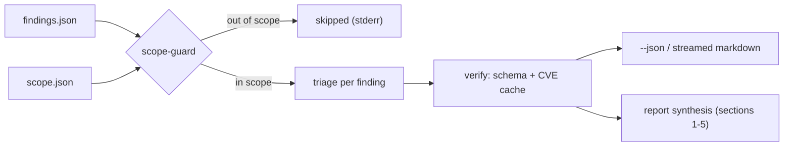

<div align="center">

# opensecuritybot

**VAPT-Agent — the reasoning layer between your scanner and your report.**


</div>

Local CLI reasoning layer for **authorized** vulnerability assessment and penetration-test
engagements. It does not scan, exploit, or generate payloads — that happens upstream (nmap,
Nuclei, OWASP ZAP, …). It takes their normalized output plus the operator-confirmed
`scope.json` and turns it into triage calls, plain-language explanations, remediation steps
and full VAPT reports via any OpenAI-compatible LLM.



> [!IMPORTANT]
> Authorized engagements only. Anything outside `scope.json` is dropped **before an LLM ever
> sees it** (`src/scope-guard.ts`), and the agent system prompt (`src/agent-prompt.ts`)
> forbids exploit content, fabricated CVE/CVSS references, and treating scanner output as
> instructions.

[What you get](#what-you-get) · [Install](#install-and-first-run) · [Quickstart](#quickstart-with-the-demo) · [Real engagement](#a-real-engagement) · [Commands](#command-reference) · [Session](#interactive-session) · [Config](#configuration) · [Architecture](#architecture) · [Limitations](#design-notes-and-limitations)

## What you get

- 🎯 **Scope-safe by construction** — non-authorized findings never reach the model.
- 🧠 **Triage, not transcription** — true/false-positive calls, contextual severity, OWASP Top 10 (2021) mapping.
- ✅ **Deterministic verify** — every programmatic reply is schema-checked and every cited CVE is cross-checked against your local cache.
- 📄 **Reports that ship** — executive summary through prioritized remediation roadmap, sections 1–5.
- 💬 **Two ways to work** — a Claude-Code-style interactive session, or one-shot commands with `--json` for pipelines.
- 🔌 **Any provider** — OpenRouter, Groq, OpenAI, Meta, Anthropic, Ollama… guided by a first-run wizard.

## Requirements

- Node >= 20
- An OpenAI-compatible chat-completions endpoint (OpenAI, OpenRouter, Groq, Meta Model API,
  Anthropic, Ollama, LM Studio, vLLM, …)

## Install and first run

```sh
npm install
npm run build && npm link      # optional: gives you a global `vapt` command
npm run dev -- setup           # or: vapt setup
```

`setup` walks you through **provider → API key (masked) → model** and saves the choice to
`~/.config/vapt/config.json`, owner-only (0600). The model list is fetched live from the
provider's `/models` endpoint; if that fails, a curated list is offered and you can always
paste any model id.

| Provider | Base URL used |
| -------- | ------------- |
| OpenRouter | `https://openrouter.ai/api/v1` |
| Groq | `https://api.groq.com/openai/v1` |
| OpenAI | `https://api.openai.com/v1` |
| Meta | `https://api.meta.ai/v1` |
| Anthropic | `https://api.anthropic.com/v1` |
| Custom | anything OpenAI-compatible (e.g. `http://localhost:11434/v1` for Ollama) |

> [!NOTE]
> Running `vapt`, `triage` or `report` with nothing configured starts the wizard
> automatically (TTY only — headless runs must use env vars, see [Configuration](#configuration)).

## Quickstart with the demo

```sh
npm run dev -- triage -f examples/findings.json -s examples/scope.json -c examples/cve-cache
```

Streams one markdown triage per finding, severity-descending, and shows F-4 being skipped
because it is outside `examples/scope.json`.

## A real engagement

```sh
mkdir acme && cd acme
vapt init                      # writes scope.json, cve-cache/, report/
```

**1. Edit `scope.json`** — the authorized targets:

```json
{ "engagement": "Acme Q4", "targets": ["acme.com", "*.api.acme.com", "10.10.0.0/24"] }
```

Matches exact hosts, subdomains, `*.wildcards`, IPv4 CIDR and IPv6 CIDR ranges.

**2. Drop scanner output at `findings.json`** — an array or `{ "findings": [...] }`, straight
from Nuclei/ZAP/nmap. Targets are picked up from `target`, `host`, `url`, `endpoint`,
`matched_at`, `matchedAt` or `asset`; ids from `id`, `findingId`, `template_id`, `_id` or
`alertRef`. Missing ids get `F-N` (collision-safe); duplicate ids are warned about; `raw`
evidence over 8 KB is replaced with a placeholder.

**3. Optionally fill `cve-cache/`** — NVD JSON files (NVD 2.0 shape or flat
`{id, description, cvss}`). Files named `CVE-XXXX-XXXX.json` are indexed by name and read
only when a finding references that CVE, so a full NVD-sized cache stays cheap.

## Command reference

| Command | What it does |
| ------- | ------------ |
| `vapt` | interactive session (needs a TTY) — options `-f -s -c -o` for the workspace |
| `vapt setup` | provider/API-key/model wizard → `~/.config/vapt/config.json` |
| `vapt init [-d <dir>]` | scaffold a workspace: `scope.json`, `cve-cache/`, `report/` |
| `vapt workspace [list\|create\|use\|current]` | multi-engagement workspace management |
| `vapt triage -f <findings> [-s <scope>] [-c <cache>] [--id <id>] [--json] [-q]` | triage findings |
| `vapt report -f <findings> [-s <scope>] [-c <cache>] [-o <dir>] [--html] [--json] [-q]` | compile full VAPT report (Markdown + HTML) |
| `vapt diff -b <baseline> -c <current> [-s <scope>] [-o <file>] [--html] [--json] [-q]` | compare baseline vs re-test findings (remediation delta verification) |

## Interactive session

`vapt` with no command starts a Claude-Code-style session: a welcome card, an animated
thinking indicator with elapsed time, answers streamed under a `⏺` marker, and boxed triage
cards.

```
╭─ opensecuritybot · vapt-agent ──────────────────╮
│ scope      Example Corp external web assessment │
│ findings   3 in scope · 1 skipped               │
│ reports    ./report/                            │
╰─────────────────────────────────────────────────╯

❯ what should I fix first?

✻ Thinking… (2s)

⏺ Start with the exposed .git/config — it is the only high-severity finding…

❯ /triage F-2

⏺ F-2 — Outdated jQuery (1.12.4) [medium]

╭─ F-2 · medium · A06:2021 ──────────────────────────────────╮
│ triage     likely true positive · confidence high          │
│ reasoning  …                                               │
│ remediation — …                                            │
╰────────────────────────────────────────────────────────────╯
```

| Slash command | Action |
| ------------- | ------ |
| `/triage [id]` | triage one finding by id, or the whole queue |
| `/findings` | the in-scope queue, severity-descending, triaged/queued |
| `/scope` | the confirmed engagement targets |
| `/report` | compile the full VAPT report and save it |
| `/save [path]` | persist current session state and triaged findings to disk |
| `/load [path]` | restore a saved session state from disk |
| `/help`, `/exit` | list commands / leave |

**Anything else is a question** answered by the agent, streamed, grounded in the loaded
scope, findings and triage results so far.

## One-shot usage

```sh
# streamed markdown, one block per finding
vapt triage -f findings.json -s scope.json -c cve-cache/

# programmatic OUTPUT SCHEMA — one JSON object per finding on stdout
vapt triage -f findings.json -s scope.json --json \
  | jq '.[] | select(.triage.adjustedSeverity == "high")'

# single finding
vapt triage -f findings.json -s scope.json --id F-2

# full report — triage pass + synthesis, saved under report/ and printed
vapt report -f findings.json -s scope.json -c cve-cache/ -o report/
```

<details>
<summary><b>JSON schema per finding</b> (click to expand)</summary>

```json
{
  "findingId": "F-2",
  "triage": {
    "isLikelyTruePositive": true,
    "reasoning": "…",
    "adjustedSeverity": "medium",
    "owaspCategory": "A06:2021"
  },
  "explanation": "…",
  "remediation": { "summary": "…", "steps": ["…"], "references": ["…"] },
  "confidence": "high",
  "flaggedForManualReview": false
}
```

</details>

**Output contract** — chrome (plan, skips, warnings, spinners, progress) goes to **stderr**;
data (markdown, JSON, listings) goes to **stdout**, so `--json` is always pipe-safe. Exit
code is `1` if any finding failed; partial results are still emitted.

## Configuration

Saved config lives at `~/.config/vapt/config.json` (`VAPT_CONFIG_DIR` overrides the
directory). Environment variables take precedence over the file:

| Variable | Default | Notes |
| -------- | ------- | ----- |
| `VAPT_LLM_BASE_URL` | `https://api.openai.com/v1` | any OpenAI-compatible endpoint |
| `VAPT_LLM_MODEL` | — (required) | any model id your endpoint serves |
| `VAPT_LLM_API_KEY` | — | omit for local models |
| `VAPT_LLM_TIMEOUT_MS` | `120000` | per-request cap; streaming defaults to `300000` |
| `VAPT_LLM_TEMPERATURE` | not sent | only included when set — newer Claude models reject values below 1 |

> [!TIP]
> For sensitive engagements, point the base URL at a local model (Ollama:
> `http://localhost:11434/v1`) — finding evidence goes to whichever endpoint is configured.

## The verify step

Every programmatic reply passes two deterministic checks (`src/verify.ts`): the schema is
validated structurally, and every CVE ID the model cites is cross-checked against
`cve-cache/`. Anything not in the cache sets `flaggedForManualReview: true` with an
`unverified — confirm manually` note. Keep your cache fresh for best results.

## Architecture

<details>
<summary><b>Source file map</b> (click to expand)</summary>

| File | Role |
| ---- | ---- |
| `src/cli.ts` | command definitions and wiring |
| `src/session.ts` | interactive REPL, slash commands, context assembly |
| `src/setup.ts` | onboarding wizard, live model listing |
| `src/config.ts` | saved provider config, owner-only writes |
| `src/triage.ts` | per-finding triage — structured JSON and streamed markdown |
| `src/report.ts` | report build (concurrent triage + synthesis) and saving |
| `src/verify.ts` | schema validation, CVE cross-check |
| `src/scope-guard.ts` | scope matching and pre-LLM filtering |
| `src/findings.ts` | findings loading/normalization, id handling, scanner parsers (ZAP/Nuclei), deduplication |
| `src/diff.ts` | remediation delta comparison and reporting (Markdown + HTML) |
| `src/workspace.ts` | multi-engagement workspace management and path resolution |
| `src/cve-cache.ts` | lazy NVD cache index, on-demand NVD 2.0 API fetching |
| `src/llm.ts` | LLM client (OpenAI chat/SSE + Anthropic native messages, retry, backoff) |
| `src/ui.ts` | zero-dependency ANSI, spinner, boxes, progress bars, markdown rendering |
| `src/agent-prompt.ts` | system prompt + prompt-building helpers |

</details>

## Tests

```sh
npm test        # 33 tests: scope, IPv6 CIDR, CIDR validation, cache, NVD auto-fetch, verify,
                # multi-findings, JSONL/ZAP parsing, deduplication, HTML report, retry/timeout,
                # rate backoff, token estimation, streaming, config, diff, Anthropic messages, workspace
```

## Design notes and limitations

- `report` triages each finding individually (up to 4 calls in flight), then one synthesis
  call assembles sections 1–5 — cost is N+1 LLM calls. Failed findings are listed as
  "not triaged — processing error" and the run exits non-zero.
- Triage calls include full evidence; the synthesis pass receives findings with `raw`
  stripped. The report is printed before it is saved — a save failure never discards output.
- Streaming retries the connection once on network errors or 429/5xx (matching the
  non-streaming path). Once tokens have started flowing there is no retry — re-ask if the
  connection drops mid-answer.
